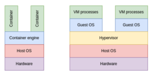

<!-- _class: lead -->
<!-- _paginate: skip -->
<!-- _footer: '' -->

# Docker : packageons nos applications pour la production

*Formation ENSAI 2025-2026*

`docker build -t mon-app:1.0 .`

---

<!-- _class: centered -->
<!-- header: 'Docker' -->

## Quels sont les cas d'utilisation de la conteneurisation ?

---

<!-- _class: centered -->

## Quels sont les avantages de la conteneurisation ?

---

<!-- _class: centered -->

## Avez-vous déjà fait de la conteneurisation ?

---

## Docker : cas d'utilisation

Docker est une solution de **conteneurisation**.

Cela permet de regrouper au sein d'un même livrable (appelé image), une application et l'ensemble des services ou configurations nécessaires à son exécution.

Ce principe garantit :
- une isolation,
- une parfaite reproductibilité.

---

## Comment cela fonctionne ?



---

## Container engine

Le container engine est le moteur permettant d'exécuter les conteneurs.

Plusieurs existent :
- Docker
- Podman
- containerd (moteur de base dans Kubernetes)

---

## Concrètement ?

Pour créer l'image Docker correspondant à une application, on va suivre les étapes suivantes :
1. Partir d'une image de base existante contenant les logiciels nécessaires (tomcat, nginx, postgresql...)
2. Adapter la configuration à notre besoin (variables d'environnement, ouverture de port...)
3. Ajouter les fichiers nécessaires (exécutables, properties...)

Ces étapes sont décrites dans un fichier de configuration appelé **Dockerfile**.

---

## Exemple de Dockerfile

```dockerfile
FROM gitlab-registry.insee.fr/kubernetes/images/run/java:25-rootless-jre
COPY --chown=$JAVA_USER:$JAVA_USER target/*.jar /usr/local/app.jar
EXPOSE 8080
ENTRYPOINT ["java", "-jar", "/usr/local/app.jar"]
```

<center>

**Commentez-moi ce fichier**

</center>

---

## Exemple de Dockerfile

```dockerfile
FROM gitlab-registry.insee.fr/kubernetes/images/run/java:25-rootless-jre
# Copie du Jar dans un répertoire avec les bons droits
COPY --chown=$JAVA_USER:$JAVA_USER target/*.jar /usr/local/app.jar
EXPOSE 8080
ENTRYPOINT ["java", "-jar", "/usr/local/app.jar"]
```

Dans cet exemple, on utilise l'image de base de run (JRE) pour la version 25 de Java.

On y retrouve :
- l'image de base utilisée : _java:25-rootless-jre_
- et quelques verbes docker (`COPY`, `EXPOSE`, `ENTRYPOINT`)

---

<!-- _class: centered -->

## Focus sur les verbes Docker

Citez-moi quelques verbes docker

---

### Focus sur les verbes Docker

Voici quelques exemples classiques :
- `FROM` : permet de choisir une image de base (un OS, des packages par défaut)
- `COPY` : permet de copier des fichiers du répertoire courant dans l'image lors de la construction
- `ENV` : permet de définir des variables d'environnement
- `ARG` : permet de mettre des arguments pendant le build

---

### Focus sur les verbes Docker

- `RUN` : permet de lancer des commandes de configuration (installation de dépendances par exemple).
- `ENTRYPOINT` : définit la commande principale du conteneur qui sera toujours exécutée. C'est l'exécutable de base.
- `CMD` : fournit des arguments par défaut à `ENTRYPOINT`, ou définit une commande par défaut si `ENTRYPOINT` n'est pas spécifié.
- `EXPOSE` : permet de configurer les ports exposés par le conteneur. Cela permet plus de documenter que de réaliser une réelle configuration réseau.

---

## Construire une image

Plusieurs méthodes :
- avec un outil en CLI (podman, docker...)
- en mode CI/CD (Gitlab, Github)

---

## Construire une image : outil en CLI

Commande de base :

```bash
docker build -t <nom_image>:<version> /path
```

Avec des arguments (si verbe ARG défini dans le Dockerfile) :

```bash
docker build --build-arg ENV=prod -t <nom_image>:<version> /path
```

Pour vérifier que l'image est bien construite :
```bash
docker images
```

---

<!-- _class: divider -->
<!-- header: '' -->

`01`

# Notion de layers

Comment Docker construit, empile et réutilise les couches d'une image

---

<!-- header: 'Layers' -->

## Notion de layers

Lors de la construction, Docker suit un modèle en couches permettant de gagner en efficacité.

Pour optimiser la construction, il est fondamental de comprendre le fonctionnement.

Docker met en cache les layers pour éviter les étapes de reconstruction inutiles.


<!-- _class: demo -->

## Le cache des layers en action

<iframe class="demo-frame" src="assets/docker-layers.html" title="Animation : le cache des couches d'une image Docker"></iframe>

---

<!-- _class: centered -->

## Pourquoi c'est une mauvaise pratique ?

```dockerfile
COPY . /app
RUN npm install
```

---

## Optimisation

Il vaut mieux passer de ça :

```dockerfile
COPY . /app        # Layer qui change à CHAQUE modification de code
RUN npm install    # Layer reconstruit à chaque fois à cause du précédent
```

À ça :

```dockerfile
COPY package.json package-lock.json ./   # Change UNIQUEMENT si les dépendances changent
RUN npm install                          # Utilisera le cache tant que package.json est identique
COPY . .                                 # Change à chaque modification de code
```

---

## .dockerignore

Ce fichier permet d'ignorer certains fichiers lors de l'étape du build.

Il ressemble particulièrement au fichier `.gitignore`.

---

<!-- _class: compact -->

## Multi-stage build

```dockerfile
FROM maven:3.9-eclipse-temurin-17 AS builder
WORKDIR /app
COPY pom.xml .
COPY src ./src
# Build l'application
RUN mvn clean package -DskipTests

FROM eclipse-temurin:17-jre-alpine
WORKDIR /app
# Copie uniquement le JAR depuis le stage builder
COPY --from=builder /app/target/*.jar app.jar
EXPOSE 8080
ENTRYPOINT ["java", "-jar", "app.jar"]
```

---

## Démo : Optimisation de la construction d'image

*Objectif* : Faire comprendre concrètement comment fonctionnent les mécanismes de build

Projet : https://github.com/InseeFrLab/vite-insee-starter/blob/main/Dockerfile

---

<!-- _class: divider -->
<!-- header: '' -->

`02`

# Exécuter et distribuer

Lancer les conteneurs et publier ses images

---

<!-- header: 'Exécution' -->

## Exécuter les conteneurs

Les conteneurs pourront s'exécuter :
- en local avec les outils comme podman / docker
- dans le contexte d'un cluster Kubernetes

---

## Exécuter les conteneurs : en local

Exemple minimal

```bash
docker run -p <PORT_MACHINE>:<CONTAINER_PORT> <nom_image>:<version>
```

---

## Exécuter les conteneurs : en local

Il est possible d'ajouter des options en plus comme :
- `-e` pour spécifier des variables d'environnement,
- `--env-file` pour spécifier un fichier `.env`,
- `-v` pour ajouter un volume pour les applications nécessitant de la persistance,
- `--name` pour donner un nom au conteneur (en exécution),
- `--network` pour gérer le réseau de conteneurs,
- `--memory` `--cpus` pour gérer les limites de ressources,
- `-d` pour exécuter en mode détaché.

---

<!-- header: 'Distribution' -->


## Mettre à disposition son image

Une fois l'image build, il est essentiel de la mettre à disposition dans un **registry d'image** :
- Docker hub : dépôt officiel docker pouvant être public,
- Github / Gitlab : possibilité d'avoir des registres liés au dépôt de code,
- Harbor : dépôt d'image sécurisé s'installant dans son infrastructure.

---

## Mettre à disposition son image : outil CLI

Après s'être login :
```bash
docker login
```
Il suffit de :
```bash
docker push monnom/monimage:latest
```
Dans le cas d'un registry privé :

```bash
docker push registry.exemple.com/mon-projet/mon-app:v1.0
```

---

<!-- _class: divider -->
<!-- header: '' -->

`03`

# Bonnes pratiques de sécurité

Moindre privilège, images minimales, vulnérabilités

---

<!-- _class: centered -->
<!-- header: 'Sécurité' -->

## Pourquoi c'est une mauvaise idée de lancer un conteneur en root en production ?

---

## Utilisateur non root

Un utilisateur root possède tous les droits au sein du conteneur, ce qui ne respecte pas le **principe du moindre privilège**.

> **Rappel** : le principe du moindre privilège consiste à limiter les droits d'un utilisateur au strict nécessaire pour répondre à son besoin.

---

## Utilisateur non root : comment le mettre en place ?

Parfois, pour construire un projet, nous avons besoin d'un utilisateur root :
- installation de packages apt,
- modification de fichiers de configuration à la racine.

Il va donc falloir jouer intelligemment entre commandes système et le verbe Docker `USER`.

---

## Utilisateur non root : démo

https://github.com/InseeFrLab/vite-insee-starter/blob/main/Dockerfile

---

## Images distroless

Ces images apportent une couche de sécurité supplémentaire puisqu'elles n'embarquent que le strict minimum pour exécuter une application :
- elles ne sont pas accessibles en mode terminal avec un `docker exec` par exemple.

Exemple d'image Java : `gcr.io/distroless/java25-debian13`

---

## Gestion des CVE

Lorsque vous développez, vous faites appel à un certain nombre de dépendances :
- packages Java, Python,
- bibliothèques système de votre système d'exploitation.

Ces dépendances peuvent contenir des vulnérabilités connues (CVE). Il est donc essentiel d'en avoir conscience et de mettre en place des scans réguliers.

---

## Gestion des CVE

Pour scanner les images Docker et leurs multiples dépendances, il est possible d'utiliser `Trivy` : un outil open source dédié à l'analyse de vulnérabilités des images.

---

<!-- header: '' -->

## Pour aller plus loin

- **Docker compose** : gérer l'exécution d'un groupe de conteneurs,
- Gestion des réseaux et du stockage persistant,
- Bonnes pratiques de sécurité (user non root, exposer le strict minimum, les CVE).

---

<!-- _class: tp -->

`TP 1`

## Conteneurisons nos applications

Construire, optimiser et publier les images d'une API Python et d'une API Java.

---

<!-- _class: centered -->

# Questions ?
