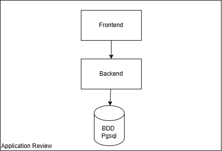

<!-- _class: lead -->
<!-- _paginate: skip -->
<!-- _footer: '' -->

# Introduction à Helm

*Formation ENSAI 2025-2026*

`helm upgrade --install mon-app ./chart`

---

<!-- _class: steps -->

## Plan

1. **Pourquoi Helm ?**\
   Les limites des manifests bruts
2. **Concepts**\
   Chart, Values, Release
3. **Composants**\
   Chart, Values, Templates, Repository
4. **Commandes**\
   Installer, mettre à jour, revenir en arrière

---

<!-- _class: divider -->

`01`

# Pourquoi Helm ?

---

<!-- header: 'Pourquoi Helm ?' -->

<!-- _class: cards -->

## Les défis sans Helm

- **Complexité des manifests**\
  Nombreux fichiers YAML à gérer, configuration dupliquée, difficile à maintenir.
- **Gestion des environnements**\
  Dev, staging, production : une configuration différente pour chaque environnement.
- **Versioning et rollback**\
  Pas de mécanisme natif de versioning des déploiements ; rollback manuel et complexe.

---

## Les avantages de Helm

- **Simplification** : regrouper plusieurs ressources K8s en un package
- **Réutilisabilité** : templates paramétrables
- **Versioning** : gestion des versions d'applications
- **Rollback facilité** : retour en arrière en une commande
- **Partage** : repository central de charts, très pratique pour l'open source

---

<!-- _class: centered -->

## Vous avez déjà utilisé des charts Helm… mais quand ?

---

<!-- _class: divider -->
<!-- header: '' -->

`02`

# Concepts

---

<!-- header: 'Concepts' -->

## Helm : le gestionnaire de packages de Kubernetes

Helm est à Kubernetes ce que :
- **apt/yum** est à Linux
- **npm** est à Node.js
- **pip** est à Python

> **Objectif** : déployer et gérer des applications Kubernetes de manière simple et reproductible.

---

## Principe de fonctionnement

```
Chart (package) + Values (config) = Release (instance déployée)
```

1. Un **Chart** contient tous les templates de ressources K8s
2. Les **Values** permettent de personnaliser le déploiement
3. La **Release** est l'application déployée dans le cluster

---

<!-- _class: divider -->
<!-- header: '' -->

`03`

# Les principaux composants

---

<!-- header: 'Composants' -->

## 1. Chart

Un **Chart** est un package Helm contenant :

```
mychart/
├── Chart.yaml          # Métadonnées du chart
├── values.yaml         # Valeurs par défaut
├── charts/             # Dépendances
└── templates/          # Templates Kubernetes
    ├── deployment.yaml
    ├── service.yaml
    └── _helpers.tpl
```

---

<!-- _class: code-sm -->

## Chart.yaml

Fichier de métadonnées du chart :

```yaml
apiVersion: v2
name: mon-application
description: Une application exemple
version: 1.0.0
appVersion: "2.4.1"
maintainers:
  - name: Votre Nom
    email: votre.email@example.com
dependencies:
  - name: postgresql
    version: "12.0.0"
    repository: "https://charts.bitnami.com/bitnami"
```

---

<!-- _class: code-sm -->

## 2. Values

Le fichier **values.yaml** contient les configurations par défaut :

```yaml
replicaCount: 2

image:
  repository: nginx
  tag: "1.21"
  pullPolicy: IfNotPresent

service:
  type: ClusterIP
  port: 80

resources:
  limits:
    cpu: 500m
    memory: 512Mi
```

---

<!-- _class: code-sm -->

## 3. Templates

Les templates utilisent le moteur **Go templating** :

```yaml
apiVersion: apps/v1
kind: Deployment
metadata:
  name: {{ .Release.Name }}-deployment
spec:
  replicas: {{ .Values.replicaCount }}
  template:
    spec:
      containers:
      - name: {{ .Chart.Name }}
        image: "{{ .Values.image.repository }}:{{ .Values.image.tag }}"
        ports:
        - containerPort: {{ .Values.service.port }}
```

---

## Variables de templating

Objets prédéfinis accessibles dans les templates :

- **`.Values`** : valeurs du values.yaml
- **`.Chart`** : contenu du Chart.yaml
- **`.Release`** : informations sur la release
  - `.Release.Name` : nom de la release
  - `.Release.Namespace` : namespace
- **`.Files`** : accès aux fichiers du chart
- **`.Capabilities`** : informations sur le cluster K8s

---

## 4. Repository

Un **Repository** est un dépôt de charts Helm :

- **Officiel** : `https://kubernetes-charts.storage.googleapis.com`
- **Bitnami** : `https://charts.bitnami.com/bitnami`
- **Privé** : hébergé en interne (Harbor, ChartMuseum, etc.)

```bash
helm repo add bitnami https://charts.bitnami.com/bitnami
helm repo update
helm search repo bitnami
```

---

<!-- _class: divider -->
<!-- header: '' -->

`04`

# Les principales commandes

---

<!-- header: 'Commandes' -->

## Gestion des repositories

```bash
# Ajouter un repository
helm repo add stable https://charts.helm.sh/stable

# Lister les repositories
helm repo list

# Mettre à jour les repositories
helm repo update

# Rechercher un chart
helm search repo nginx
```

---

<!-- _class: code-sm -->

## Installation et déploiement

```bash
# Installer un chart
helm install mon-release bitnami/nginx

# Installer avec des valeurs personnalisées
helm install mon-release bitnami/nginx -f custom-values.yaml

# Installer avec des valeurs en ligne de commande
helm install mon-release bitnami/nginx --set replicaCount=3

# Installation en mode debug (affiche les manifests générés)
helm install mon-release bitnami/nginx --dry-run --debug
```

---

## Installation

En pratique, afin d'éviter d'avoir des erreurs si la release existe déjà, on utilise la commande :

```bash
helm upgrade --install
```

---

<!-- _class: code-sm -->

## Gestion des releases

```bash
# Lister les releases
helm list
helm list -A  # Tous les namespaces

# Obtenir les informations d'une release
helm status mon-release

# Obtenir les valeurs d'une release
helm get values mon-release

# Obtenir tous les manifests d'une release
helm get manifest mon-release
```

---

<!-- _class: code-sm -->

## Mise à jour et rollback

```bash
# Mettre à jour une release
helm upgrade mon-release bitnami/nginx -f new-values.yaml

# Upgrade ou install (utile pour CI/CD)
helm upgrade --install mon-release bitnami/nginx

# Historique des versions
helm history mon-release

# Rollback vers une version précédente
helm rollback mon-release 1
```

---

## Mise à jour et rollback : flags intéressants

Lorsque vous faites un `helm upgrade`, ce dernier ne conserve pas les anciennes values. Le flag `--reuse-values` permet de les conserver :

```bash
helm install demo podinfo/podinfo -n helm-demo \
  -f values-dev.yaml
helm upgrade demo podinfo/podinfo -n helm-demo \
  --reuse-values \
  --set replicaCount=3
```

---

## Désinstallation

```bash
# Désinstaller une release
helm uninstall mon-release

# Désinstaller en gardant l'historique
helm uninstall mon-release --keep-history

# Lister les releases désinstallées
helm list --uninstalled
```

---

## Désinstallation : spécificités

Lors d'un `helm uninstall`, la commande ne supprime pas :
- les PVC, afin de protéger les données (sauf si `helm.sh/resource-policy: delete`),
- les namespaces,
- les CRDs,
- les ressources créées manuellement.

---

<!-- _class: code-sm -->

## Création et développement de charts

```bash
# Créer un nouveau chart
helm create mon-chart

# Valider un chart
helm lint mon-chart

# Packager un chart
helm package mon-chart

# Installer un chart local
helm install mon-release ./mon-chart

# Templater sans installer
helm template mon-release ./mon-chart

# Installation en mode debug (affiche les manifests générés)
helm install mon-release bitnami/nginx --dry-run --debug
```

---

## Gestion des dépendances



---

<!-- _class: code-sm -->

## Gestion des dépendances

Dans notre Chart.yaml, cela se matérialisera par un chart global qui possède 3 dépendances :

```yaml
apiVersion: v2
name: 3tier-umbrella
description: |
...
dependencies:
  - name: backend
    version: "0.1.0"
    repository: "file://charts/backend"
  - name: frontend
    version: "0.1.0"
    repository: "file://charts/frontend"
  - name: postgresql
    version: "16.4.1"
    repository: "https://charts.bitnami.com/bitnami"
    alias: postgresql
```

---

## Gestion des dépendances : commandes utiles

```bash
# Afficher les dépendances
helm dependency list mon-chart

# Télécharger les dépendances
helm dependency update mon-chart
```

---

<!-- header: '' -->

## Bonnes pratiques

1. **Toujours versionner vos charts** (Chart.yaml)
2. **Utiliser des values.yaml pour les configurations**
3. **Tester avec `--dry-run --debug`** avant installation
4. **Documenter vos charts** (README.md)
5. **Valider avec `helm lint`** avant de packager
6. **Gérer les secrets avec des outils appropriés** (Sealed Secrets, External Secrets)

---

<!-- _class: tp -->

`TP 7`

## Packager le backend avec Helm

Créer un chart, ajouter PostgreSQL (CloudNativePG) en dépendance, puis tester upgrade et rollback.

---

<!-- _class: centered -->

# Questions ?
