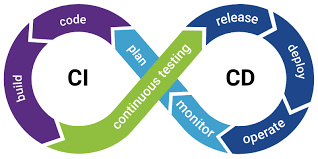
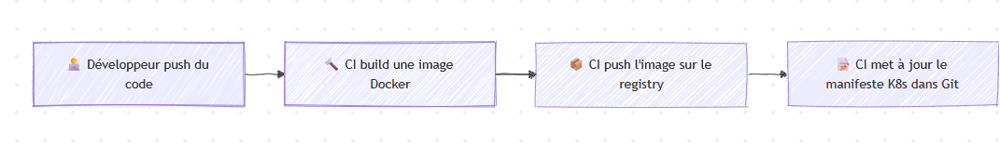

<!-- _class: lead -->
<!-- _paginate: skip -->
<!-- _footer: '' -->

# Mise à jour dans Kubernetes

Stratégies et automatisation

`kubectl rollout status deployment/mon-app`

---

<!-- _class: steps -->

## Plan

1. **RollingUpdate**\
   Mettre à jour sans interruption, probes, rollback
2. **Continuous Delivery**\
   Pipelines, GitOps et ArgoCD

---

<!-- _class: divider -->

`01`

# RollingUpdate

---

<!-- header: 'RollingUpdate' -->

## Qu'est-ce qu'une mise à jour ?

Dans Kubernetes, une mise à jour consiste à :
- changer la version d'une image de conteneur,
- modifier la configuration d'une application,
- ajuster les ressources (CPU, mémoire).

> **Objectif** : mettre à jour l'application sans interruption de service.

---

<!-- _class: cards -->

## Les stratégies de déploiement

- **Recreate**\
  Arrêt total puis redémarrage. Downtime inévitable : simple mais non recommandé en production.
- **RollingUpdate**\
  Mise à jour progressive, sans downtime. Stratégie par défaut, **recommandée pour la production**.

---

## RollingUpdate : principe

Remplacement progressif des anciens pods par des nouveaux :

```
Version 1:  🟦 🟦 🟦 🟦 🟦
            ↓
Transition: 🟦 🟦 🟦 🟩 🟩
            ↓
Version 2:  🟩 🟩 🟩 🟩 🟩
```

- Les nouveaux pods sont créés progressivement
- Les anciens pods sont supprimés une fois les nouveaux prêts
- Le service reste disponible durant toute la mise à jour

---

<!-- _class: code-sm -->

## Configuration dans un Deployment

```yaml
apiVersion: apps/v1
kind: Deployment
metadata:
  name: mon-app
spec:
  replicas: 5
  strategy:
    type: RollingUpdate
    rollingUpdate:
      maxUnavailable: 1    # Max de pods indisponibles
      maxSurge: 1          # Max de pods supplémentaires
  template:
    spec:
      containers:
      - name: app
        image: mon-app:v2.0
```

---

<!-- _class: cards -->

## Paramètres RollingUpdate

- **`maxUnavailable`**\
  Nombre ou pourcentage maximum de pods pouvant être indisponibles. `maxUnavailable: 1` : au plus 1 pod arrêté à la fois. Défaut : 25 %.
- **`maxSurge`**\
  Nombre ou pourcentage maximum de pods supplémentaires créés. `maxSurge: 1` : au plus 1 pod en plus du nombre désiré. Défaut : 25 %.

---

<!-- _class: code-sm -->

## Exemple avec 5 replicas

Configuration :
```yaml
replicas: 5
maxUnavailable: 1
maxSurge: 1
```

Déroulement :
```
Étape 1: 🟦 🟦 🟦 🟦 🟦     (5 pods v1)
Étape 2: 🟦 🟦 🟦 🟦 🟩 🟩   (4 v1 + 2 v2, max surge)
Étape 3: 🟦 🟦 🟦 🟩 🟩     (3 v1 + 2 v2)
Étape 4: 🟦 🟦 🟩 🟩 🟩 🟩   (2 v1 + 4 v2)
Étape 5: 🟦 🟩 🟩 🟩 🟩     (1 v1 + 4 v2)
Étape 6: 🟩 🟩 🟩 🟩 🟩     (5 pods v2)
```

---

<!-- _class: code-sm -->

## Probes et RollingUpdate

Les **probes** garantissent que les nouveaux pods sont prêts :

```yaml
containers:
- name: app
  image: mon-app:v2.0
  readinessProbe:
    httpGet:
      path: /health
      port: 8080
    initialDelaySeconds: 5
    periodSeconds: 5
  livenessProbe:
    httpGet:
      path: /health
      port: 8080
    initialDelaySeconds: 15
    periodSeconds: 10
```

---

<!-- _class: centered -->
<!-- header: 'Probes' -->

## Détour par les probes

Liveness, Readiness, Startup

---

<!-- _class: cards -->

## Les différentes probes

- **Readiness**\
  Le pod est-il prêt à recevoir du trafic ? En cas d'échec, il est retiré du Service. **Crucial pour le RollingUpdate** : les nouveaux pods sont validés avant la suppression des anciens.
- **Liveness**\
  Le pod est-il en vie ? En cas d'échec, il est redémarré par Kubernetes. Protège contre les applications bloquées.
- **Startup**\
  Pour les applications longues à démarrer : attend que l'application soit démarrée avant de lancer les autres probes. En cas d'échec, le pod est redémarré.

---

## Que tester ? HTTP probe

Vérifie un endpoint HTTP d'un conteneur :

```yaml
livenessProbe:
  httpGet:
    path: /live
    port: 8080
  initialDelaySeconds: 5
  periodSeconds: 10
  timeoutSeconds: 2
```

**Cas d'usage** : applications web

---

## Que tester ? TCP probe

Vérifie que le port TCP est ouvert et accepte une connexion :

```yaml
readinessProbe:
  tcpSocket:
    port: 3306
  initialDelaySeconds: 5
  periodSeconds: 10
```

**Cas d'usage** : bases de données, brokers ou services sans endpoint HTTP

---

<!-- _class: centered -->

## Que se passe-t-il en cas d'échec ?

---

## Processus de redémarrage

Si la startup probe ou la liveness probe échoue, Kubernetes suit un processus bien défini :
1. Envoi par kubelet d'un signal `SIGTERM` pour que l'application gère son interruption
2. Kubernetes attend (`terminationGracePeriodSeconds`)
3. Si le conteneur n'est pas arrêté, kubelet envoie un signal `SIGKILL`

> Il est donc important de gérer ces signaux dans le développement d'une application.

---

<!-- _class: centered -->
<!-- header: 'RollingUpdate' -->

## Retour à nos rolling updates

---

## Suivre une mise à jour

```bash
# Voir le statut du rollout
kubectl rollout status deployment/mon-app

# Voir l'historique
kubectl rollout history deployment/mon-app

# Voir les détails d'une révision
kubectl rollout history deployment/mon-app --revision=2

# Voir les events en temps réel
kubectl get events --watch
```

---

## Pause et reprise

```bash
# Mettre en pause un rollout
kubectl rollout pause deployment/mon-app

# Faire des modifications supplémentaires
kubectl set resources deployment/mon-app -c=app \
  --limits=cpu=500m,memory=512Mi

# Reprendre le rollout
kubectl rollout resume deployment/mon-app
```

**Utilité** : grouper plusieurs modifications en un seul rollout

---

## Rollback

Si la nouvelle version pose problème :

```bash
# Annuler le dernier rollout
kubectl rollout undo deployment/mon-app

# Revenir à une révision spécifique
kubectl rollout undo deployment/mon-app --to-revision=3

# Vérifier le statut
kubectl rollout status deployment/mon-app
```

> **Important** : le rollback utilise aussi la stratégie RollingUpdate.

---

## Limiter l'historique des révisions

```yaml
apiVersion: apps/v1
kind: Deployment
metadata:
  name: mon-app
spec:
  revisionHistoryLimit: 10  # Garder 10 révisions
  replicas: 5
  strategy:
    type: RollingUpdate
  # ...
```

Par défaut : 10 révisions conservées

---

<!-- _class: code-sm -->

## Stratégie Recreate (pour comparaison)

```yaml
apiVersion: apps/v1
kind: Deployment
metadata:
  name: mon-app
spec:
  replicas: 3
  strategy:
    type: Recreate  # Tous les pods stoppés puis recréés
  template:
    spec:
      containers:
      - name: app
        image: mon-app:v2.0
```

**Cas d'usage** : applications stateful qui ne supportent pas plusieurs versions simultanées

---

<!-- _class: tp -->
<!-- header: '' -->

`TP 5`

## Mettons à jour nos applications

Ajouter des probes, observer un RollingUpdate et effectuer un rollback.

---

<!-- _class: divider -->

`02`

# Continuous Delivery

---

<!-- header: 'Continuous Delivery' -->

## Qu'est-ce que la Continuous Delivery ?

**Continuous Delivery (CD)** : pratique permettant de livrer du code en production de manière fréquente, fiable et automatisée.

**Objectifs** :
- réduire le temps entre l'écriture du code et sa mise en production,
- automatiser le déploiement,
- réduire les risques liés aux déploiements,
- permettre des retours rapides.

---

## Pipeline CI/CD



---

<!-- _class: cards -->

## Push vs Pull

- **Push model**\
  `CI/CD → push → cluster`\
  Jenkins, GitLab CI, GitHub Actions. Le pipeline pousse les changements : accès direct au cluster requis.
- **Pull model (GitOps)**\
  `Git ← poll ← agent dans K8s`\
  ArgoCD, Flux. Un agent dans le cluster tire les changements : plus sécurisé, audit trail complet.

---

## Principes de la Continuous Delivery

1. **Automatisation** : tout doit être automatisé
2. **Répétabilité** : le processus doit être identique à chaque fois
3. **Versioning** : tout doit être versionné (code + infra)
4. **Tests automatisés** : validation à chaque étape
5. **Déploiements fréquents** : petits changements réguliers
6. **Rollback rapide** : capacité à revenir en arrière facilement

---

## GitOps : l'évolution de la CD

**GitOps** : approche où Git est la source de vérité pour l'infrastructure et les applications.

- **Déclaratif** : état désiré défini en YAML
- **Versionné** : tout dans Git
- **Automatique** : synchronisation continue
- **Auditable** : historique complet des changements

```
Git (source de vérité) → Agent GitOps → Kubernetes
```

---

## Workflow GitOps typique




---

<!-- _class: cards -->

## Outils de CD pour Kubernetes

- **Push-based**\
  Jenkins X, GitLab CI/CD, GitHub Actions, Spinnaker
- **Pull-based (GitOps)**\
  **ArgoCD** (outil utilisé à l'INSEE), Flux CD, Jenkins X (mode GitOps)

---

<!-- _class: centered -->

## Démo dans le cadre INSEE

---

<!-- header: '' -->

## Ressources utiles

- **RollingUpdate & Deployments** : [kubernetes.io/docs/…/deployment](https://kubernetes.io/docs/concepts/workloads/controllers/deployment/)
- **GitOps** : [gitops.tech](https://www.gitops.tech/)
- **ArgoCD** : [argo-cd.readthedocs.io](https://argo-cd.readthedocs.io/) · [argoproj.github.io](https://argoproj.github.io/)
- **Argo Rollouts** (stratégies avancées) : [argoproj.github.io/rollouts](https://argoproj.github.io/rollouts/)

---

<!-- _class: centered -->

# Questions ?
