<!-- _class: lead -->
<!-- _paginate: skip -->
<!-- _footer: '' -->

# Kubernetes pour les développeurs

*Formation ENSAI 2025-2026*

`kubectl get pods --all-namespaces`

---

<!-- _class: steps -->

## Sommaire

1. **Architecture**\
   Comprendre le fonctionnement du cluster
2. **Premiers pas**\
   Pods, Deployments, Services, Ingress
3. **Persistance**\
   Volumes, PV/PVC, StatefulSet
4. **CRD et Opérateurs**\
   Étendre Kubernetes

---

<!-- _class: divider -->

`01`

# Architecture Kubernetes

Objectif : comprendre comment fonctionne Kubernetes pour mieux l'utiliser par la suite.

---

<!-- _class: centered -->
<!-- header: 'Architecture' -->

## Kubernetes, késako ?

---

## Principe

Kubernetes permet :
- une orchestration automatique des conteneurs à l'échelle,
- d'assurer la haute disponibilité sur nos applications à l'aide de redémarrage automatique,
- de mettre à jour sans interruption,
- de gérer les interconnexions réseaux.

---

<!-- _class: centered -->

## Fonctionnement

Construisons un cluster, étape par étape.

---

## Construisons notre cluster

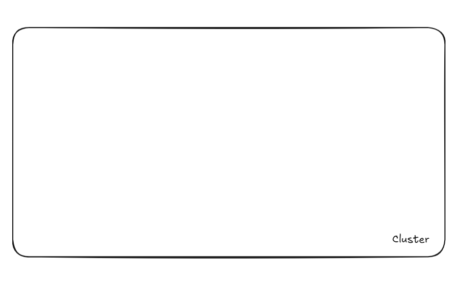

---

## Ajoutons des nodes

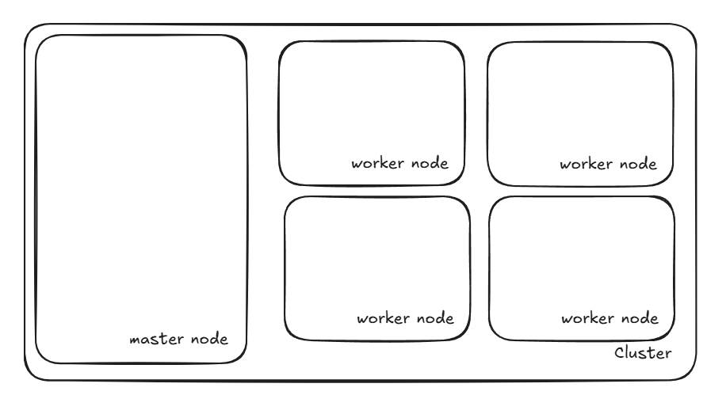

---

## Composants du master node

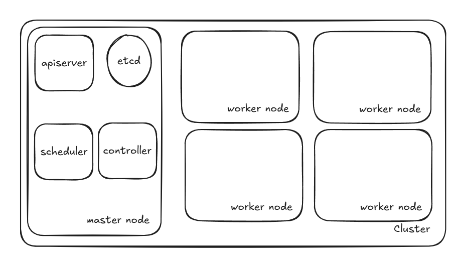

---

## Composants du worker node

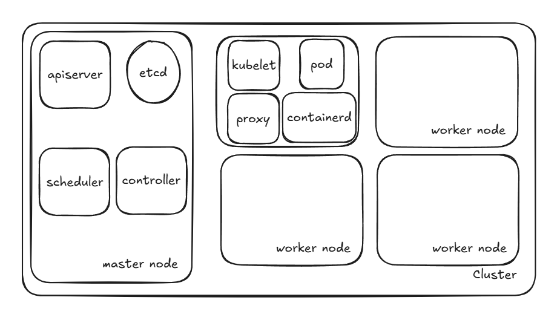

---

## Fonctionnement : cluster

Un **cluster** est un ensemble de plusieurs ordinateurs (nœuds) qui travaillent ensemble comme un système unique pour améliorer la performance, la disponibilité ou la capacité de traitement.

---

## Fonctionnement : socle

Pour que Kubernetes fonctionne, il faut des serveurs : les nœuds du cluster.

Deux types de nœuds :
- **master node** : permet d'exécuter les processus de Kubernetes
- **worker node** : permet d'exécuter les charges de travail

---

<!-- _class: compact -->

## Composants du master node

- **kube-apiserver** : expose l'interface pour l'utilisation du cluster Kubernetes.
- **etcd** : base de données clé-valeur des informations clés.
- **kube-scheduler** : planificateur décidant sur quel nœud worker placer les nouvelles applications en fonction des ressources disponibles et des contraintes définies.
- **kube-controller-manager** : contrôle l'état du cluster.

> Ces éléments définissent ce qu'on nomme le **control plane**.

---

<!-- _class: compact -->

## Composants des worker nodes

- **kubelet** : agent responsable de démarrer, arrêter et surveiller les pods et conteneurs en communiquant avec le control plane via l'API server.
- **kube-proxy** : le proxy réseau qui gère les règles de routage et le load balancing pour permettre la communication entre les pods et vers l'extérieur du cluster.
- **Container Runtime** : le logiciel responsable de l'exécution des conteneurs (Docker, containerd, CRI-O, etc.) qui fait tourner réellement les applications conteneurisées.

---

## Multitenancy : namespace

Kubernetes offre la possibilité d'héberger facilement plusieurs applications / groupes d'applications avec une bonne isolation.

Pour ce faire, il utilise le principe de **namespace**.

---

## Comment créer une application ?

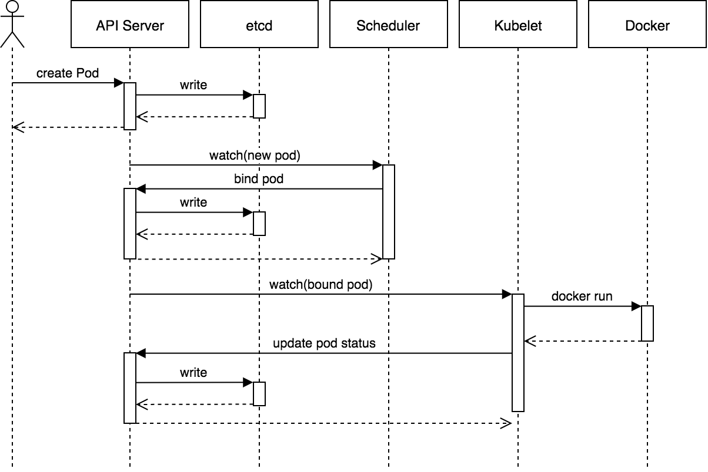

---

<!-- _class: demo -->

## Récapitulons 

<iframe class="demo-frame" src="assets/k8s-pod.html" title="Animation : scheduling d'un pod"></iframe>


---

<!-- _class: divider -->
<!-- header: '' -->

`02`

# Premiers pas dans Kubernetes

Objectif : savoir déployer une application dans Kubernetes.

---

<!-- header: 'Premiers pas' -->

## Comment communiquer avec l'API server ?

- un outil : **kubectl**
- un format de fichier : **yaml** ou **json**
- des spécifications pour créer les objets : Pods, ReplicaSet, Deployment, Service…

---

<!-- _class: centered -->

## Quelle est la plus petite unité dans Kubernetes ?

---

## Les principaux objets Kubernetes : Pod

Le plus petit élément dans Kubernetes est le **Pod**, qui permet d'exécuter une instance d'une application.

```yaml
apiVersion: v1
kind: Pod
metadata:
  name: mon-pod
spec:
  containers:
    - name: masuperapp
      image: masuperapp:latest
      ports:
        - containerPort: 8080
```

---

## Les principaux objets Kubernetes : Pod

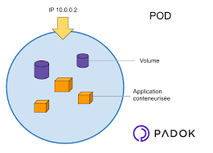

---

<!-- _class: centered -->

## Comment gérer la scalabilité ?

---

## Les principaux objets Kubernetes : ReplicaSet

Cet objet permet de déclarer directement plusieurs « replicas » de pods afin de passer une application à l'échelle.

> Cet objet n'est pas très utilisé directement : il est préférable d'utiliser un **Deployment**.

---

<!-- _class: code-sm -->

## ReplicaSet : exemple

```yaml
apiVersion: apps/v1
kind: ReplicaSet
metadata:
  name: echo-replicaset
spec:
  replicas: 3
  selector:
    matchLabels:
      app: echo
  template:
    metadata:
      labels:
        app: echo
    spec:
      containers:
      - name: echo-container
        image: hashicorp/http-echo:0.2.3
        args:
          - "-text=Hello from ReplicaSet"
        ports:
        - containerPort: 5678
```

---

## Les principaux objets Kubernetes : Deployment

Le Deployment gère les ReplicaSets afin de mettre à jour l'application sans interruption. Cet objet offre donc plus de flexibilité que le ReplicaSet.

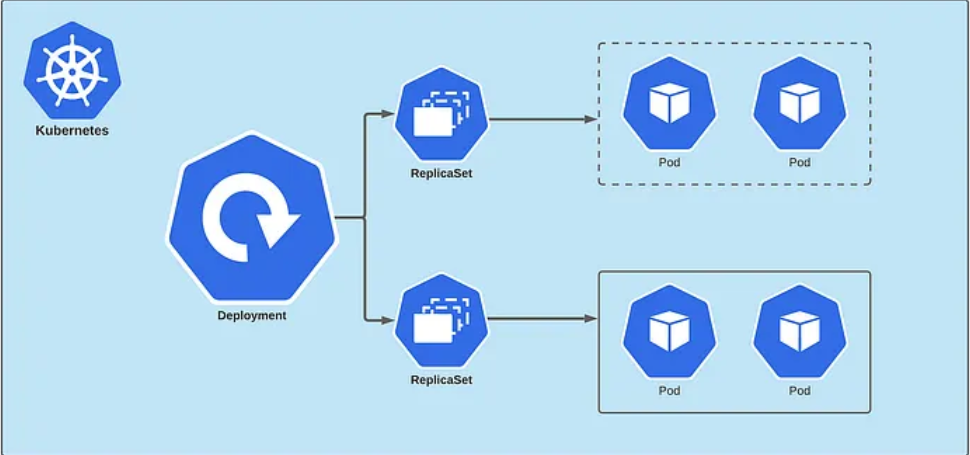

---

<!-- _class: code-sm -->

## Deployment : exemple

```yaml
apiVersion: apps/v1
kind: Deployment
metadata:
  name: echo-server
  labels:
    app: echo
spec:
  replicas: 3
  selector:
    matchLabels:
      app: echo
  template:
    metadata:
      labels:
        app: echo
    spec:
      containers:
      - name: echo-container
        image: hashicorp/http-echo:0.2.3
        args:
          - "-text=Hello Kubernetes!"
        ports:
        - containerPort: 5678
```

---

<!-- _class: tp -->

`TP 2`

## Premiers pas dans Kubernetes

Déployer trois replicas d'une API Python et la tester sans l'exposer.

---

<!-- _class: centered -->
<!-- header: 'Exposition' -->

## Comment exposer mon application ?

---

<!-- _class: centered -->

## Quelles sont les 7 couches du modèle OSI ?

---

<!-- _class: centered -->

## Pas besoin de les connaître pour exposer mon application sur un cluster Kubernetes

---

## Les principaux objets Kubernetes : Service

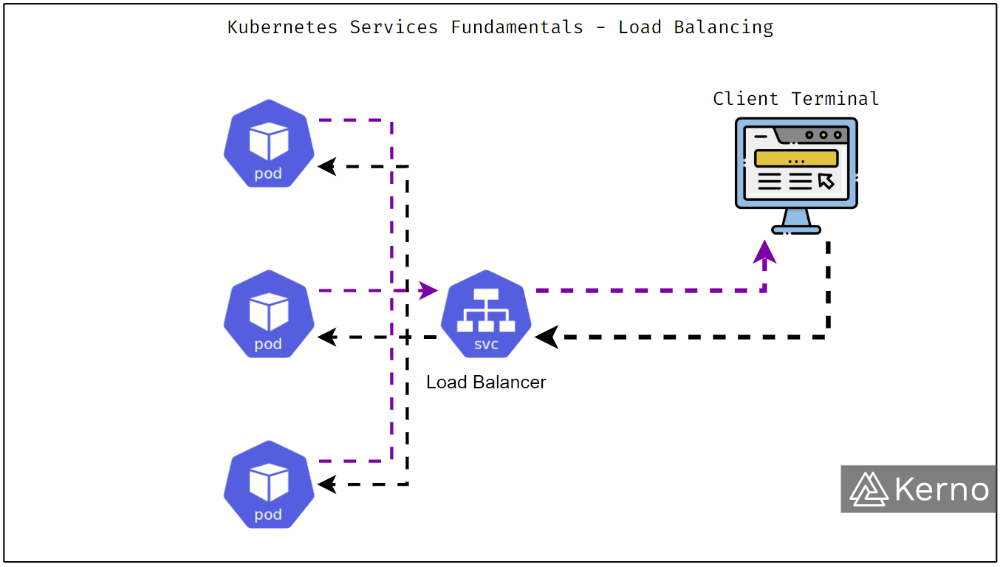

---

## Les principaux objets Kubernetes : Service

Il existe différents types de services :
- **ClusterIP** : réservé à la communication interne,
- **NodePort** : expose un port du nœud,
- **LoadBalancer** : s'appuie sur l'infrastructure cloud pour exposer directement sur internet avec un équilibreur de charge,
- **ExternalName** : redirection des requêtes vers un nom de domaine externe.

---

## Service : exemple

```yaml
apiVersion: v1
kind: Service
metadata:
  name: backend-service
spec:
  selector:
    app: backend
  ports:
    - protocol: TCP
      port: 80
      targetPort: 8080
  type: ClusterIP
```

---

<!-- _class: centered -->

## Dans le cas du ClusterIP, mon application n'est toujours pas accessible depuis internet ?

---

## Les principaux objets Kubernetes : Ingress

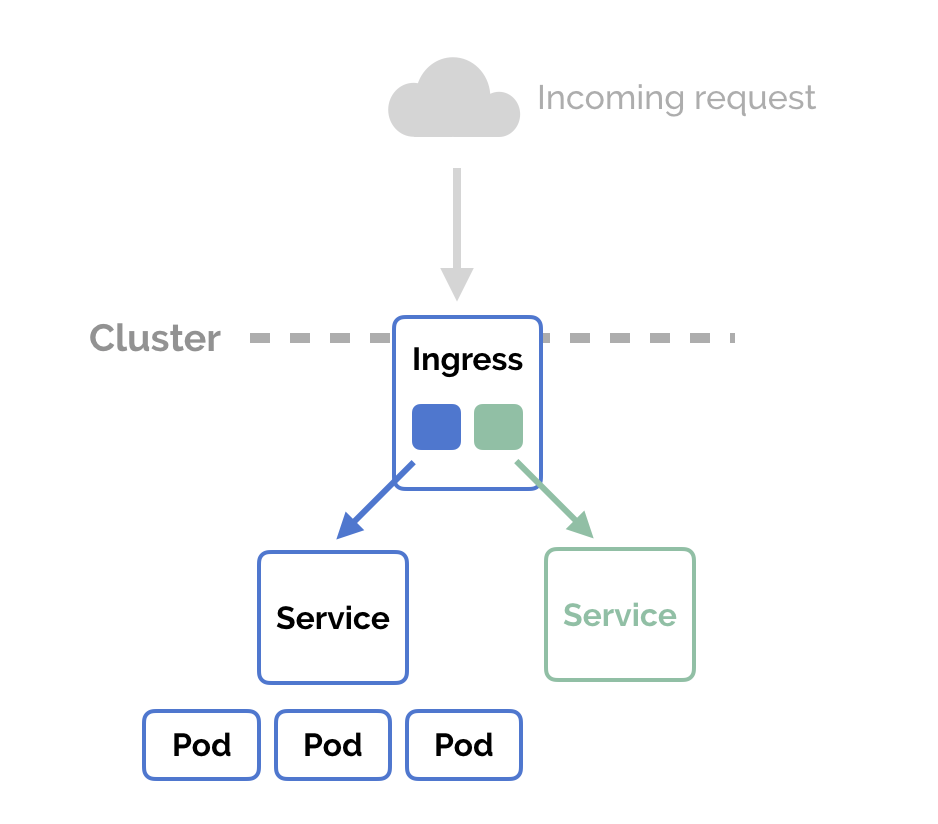

---

## Les principaux objets Kubernetes : Ingress

Pour faire fonctionner l'Ingress, il faut installer un **controller** comme :
- cilium ingress controller,
- envoy ingress controller,
- nginx ingress controller (fin de maintenance cette année).

L'ingress controller agit donc comme un routeur central redirigeant les requêtes vers les différentes applications à l'intérieur du cluster.

---

## Les principaux objets Kubernetes : Ingress

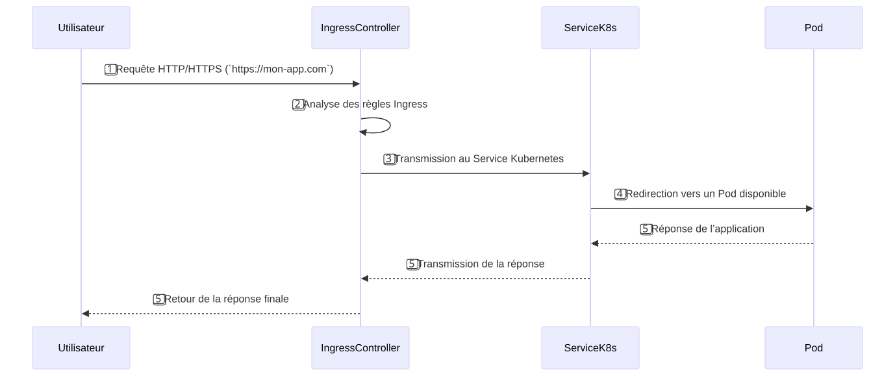

---

<!-- _class: code-sm -->

## Ingress : exemple

```yaml
apiVersion: networking.k8s.io/v1
kind: Ingress
metadata:
  name: webapp-ingress
  annotations:
    nginx.ingress.kubernetes.io/rewrite-target: /
spec:
  rules:
  - host: webapp.local
    http:
      paths:
      - path: /
        pathType: Prefix
        backend:
          service:
            name: webapp-service
            port:
              number: 80
```

---

## Pour aller plus loin : Gateway API

Ingress n'aura plus d'évolution par la communauté Kubernetes : **Gateway API** sera la nouvelle solution à privilégier.

Il existe aussi la notion d'**Egress** permettant de gérer les flux sortants du cluster. Cela peut être utile pour mettre en place un proxy et contrôler le trafic sortant. Exemple : [Egress avec Squid](https://interlaye.red/kubernetes_002degress_002dsquid.html).

---

<!-- _class: tp -->

`TP 3`

## Exposons notre application sur Internet

Service, Ingress, puis déploiement d'une application 3 tiers.

---

<!-- header: 'Configuration' -->

## Configurons nos applications : ConfigMap

Kubernetes propose un objet permettant d'injecter de la configuration en variables d'environnement dans les applications.

Pour garder de la flexibilité, il est possible d'y mettre :
- l'URL de la base de données,
- le niveau de log,
- des fichiers de configuration complets.

---

## ConfigMap : exemple

```yaml
apiVersion: v1
kind: ConfigMap
metadata:
  name: app-config
data:
  DATABASE_URL: "postgresql://db.example.com:5432"
  LOG_LEVEL: "info"
  APP_PORT: "8080"
```

---

## Gérons nos ressources

Dans Kubernetes, lors de la création d'un pod, il est important de définir les ressources nécessaires à son exécution.

Cela permet :
- de s'assurer que Kubernetes provisionne assez de ressources pour faire fonctionner l'application,
- de gérer les ressources des nœuds.

---

<!-- _class: code-sm -->

## Gérons nos ressources : exemple

```yaml
apiVersion: apps/v1
kind: Deployment
...
      containers:
      - name: app-container
        image: nginx:1.21
        ports:
        - containerPort: 80
        resources:
          requests:
            memory: "256Mi"
            cpu: "250m"
          limits:
            memory: "512Mi"
            cpu: "500m"
```

---

## Actions préalables à l'exécution : init-containers

Dans certains cas, pour des raisons d'architecture, il est préférable de lancer des actions avant le démarrage de notre application.

> Par exemple, pour une API d'IA, il faut télécharger un modèle de plusieurs Go avant de lancer l'application.

---

<!-- _class: code-sm -->

## Init-containers : exemple

```yaml
apiVersion: apps/v1
kind: Deployment
...
    spec:
      initContainers:
      - name: init-database
        image: mysql:5.7
        command: ['sh', '-c', 'mysql -h db -u root -p$MYSQL_ROOT_PASSWORD < /scripts/init.sql']
        volumeMounts:
        - name: init-scripts
          mountPath: /scripts
        env:
        - name: MYSQL_ROOT_PASSWORD
          valueFrom:
            secretKeyRef:
              name: mysql-secrets
              key: root-password
      containers: ...
```

---

<!-- _class: divider -->
<!-- header: '' -->

`03`

# Gestion de la persistance

Objectif : savoir gérer son stockage sur Kubernetes.

---

<!-- header: 'Persistance' -->

## Qu'est-ce qu'un Volume ?

- Répertoire accessible aux conteneurs d'un Pod
- Cycle de vie lié au Pod (pas au conteneur)
- Permet le partage de données entre conteneurs
- Survit aux redémarrages de conteneurs

---

## Volumes : quand les utiliser ?

- **Partage de données** entre conteneurs d'un même Pod
- **Stockage temporaire** durant la vie du Pod
- **Configuration** et secrets

---

## Types courants

- **emptyDir** : répertoire vide créé avec le Pod
- **hostPath** : montage d'un chemin du nœud (non recommandé)
- **configMap** : injection de configuration
- **secret** : injection de données sensibles
- **persistentVolumeClaim** : stockage persistant

---

<!-- _class: code-sm -->

## Exemple : emptyDir partagé entre deux conteneurs

```yaml
apiVersion: v1
kind: Pod
metadata:
  name: pod-avec-volume
spec:
  containers:
  - name: nginx
    image: nginx
    volumeMounts:
    - name: cache-volume
      mountPath: /cache
  - name: sidecar
    image: busybox
    command: ['sh', '-c', 'while true; do date >> /cache/log.txt; sleep 5; done']
    volumeMounts:
    - name: cache-volume
      mountPath: /cache
  volumes:
  - name: cache-volume
    emptyDir: {}
```

---

<!-- _class: code-sm -->

## Exemple : ConfigMap monté en volume

```yaml
apiVersion: v1
kind: ConfigMap
metadata:
  name: app-config
data:
  app.properties: |
    database.url=postgres://db:5432
    log.level=info
---
apiVersion: v1
kind: Pod
metadata:
  name: app-pod
spec:
  containers:
  - name: app
    image: myapp:1.0
    volumeMounts:
    - name: config
      mountPath: /etc/config
  volumes:
  - name: config
    configMap:
      name: app-config
```

---

## Stockage du pod : ephemeral storage

- Stockage temporaire fourni par le nœud
- **Disparaît** quand le Pod est supprimé
- Situé sur le disque local du nœud
- Limité par les ressources du nœud

---

<!-- _class: code-sm -->

## Ephemeral storage : exemple

```yaml
apiVersion: v1
kind: Pod
metadata:
  name: data-processor
spec:
  containers:
  - name: processor
    image: data-processor:1.0
    resources:
      requests:
        ephemeral-storage: "5Gi"
      limits:
        ephemeral-storage: "10Gi"
    volumeMounts:
    - name: temp-data
      mountPath: /tmp/processing
  volumes:
  - name: temp-data
    emptyDir:
      sizeLimit: 8Gi
```

---

## Persistent Volumes : architecture

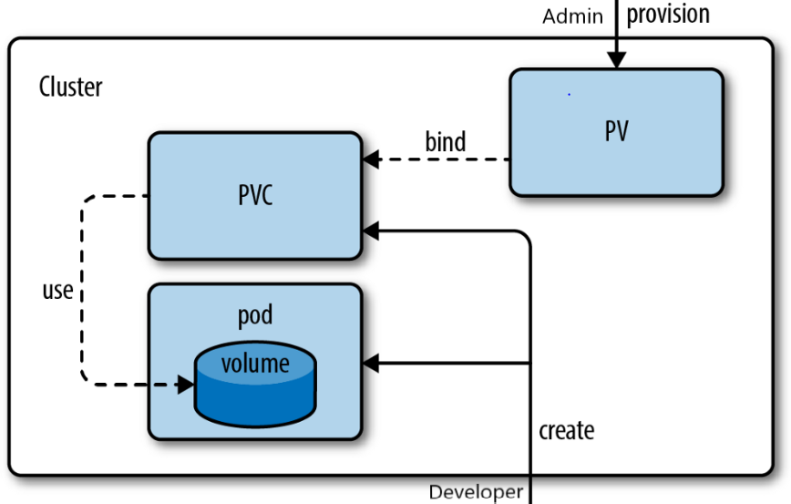

---

## Persistent Volume (PV)

- Ressource de stockage dans le cluster
- **Provisionné par l'admin** ou dynamiquement
- Cycle de vie **indépendant** des Pods
- Abstraction du stockage physique

---

## Types de PV

- NFS, iSCSI
- Cloud providers (AWS EBS, Azure Disk, GCP PD)
- Ceph, GlusterFS
- Local storage

---

## Modes d'accès

- **ReadWriteOnce (RWO)** : lecture-écriture par un seul nœud
- **ReadOnlyMany (ROX)** : lecture seule par plusieurs nœuds
- **ReadWriteMany (RWX)** : lecture-écriture par plusieurs nœuds

---

## Reclaim Policies

- **Retain** : données conservées après suppression du PVC
- **Delete** : suppression automatique
- **Recycle** : nettoyage basique (déprécié)

---

## PV : exemple

```yaml
apiVersion: v1
kind: PersistentVolume
metadata:
  name: pv-nfs-data
spec:
  capacity:
    storage: 10Gi
  accessModes:
    - ReadWriteMany
  persistentVolumeReclaimPolicy: Retain
  nfs:
    server: nfs-server.example.com
    path: "/exports/data"
  storageClassName: nfs-storage
```

---

## Persistent Volume Claim (PVC)

- **Demande** de stockage par un utilisateur
- Spécifie taille, mode d'accès, storage class
- Kubernetes **associe** (bind) le PVC à un PV compatible
- Utilisé par les Pods pour monter le stockage

---

## PVC : exemple simple

```yaml
apiVersion: v1
kind: PersistentVolumeClaim
metadata:
  name: data-claim
spec:
  accessModes:
    - ReadWriteOnce
  resources:
    requests:
      storage: 5Gi
  storageClassName: standard
```

---

<!-- _class: code-sm -->

## PVC : utilisation dans un Pod

```yaml
apiVersion: v1
kind: Pod
metadata:
  name: database-pod
spec:
  containers:
  - name: postgres
    image: postgres:14
    volumeMounts:
    - name: postgres-storage
      mountPath: /var/lib/postgresql/data
    env:
    - name: POSTGRES_PASSWORD
      value: "secretpassword"
  volumes:
  - name: postgres-storage
    persistentVolumeClaim:
      claimName: data-claim
```

---

## PV/PVC : cas d'usage

- **Bases de données** (PostgreSQL, MySQL, MongoDB)
- **Stockage de fichiers** utilisateurs
- **Applications stateful** nécessitant de la persistance
- **Logs et métriques** à long terme
- **Partage de données** entre Pods (RWX)

---

## StatefulSet ?

Controller pour **applications avec état** (stateful).

Garanties :
- **Identité réseau stable** : nom DNS prévisible
- **Stockage persistant** : un PVC par Pod
- **Ordre de déploiement** : démarrage/arrêt ordonné
- **Ordre de mise à jour** : rolling update contrôlé

---

## StatefulSet vs Deployment

| Aspect | Deployment | StatefulSet |
|--------|-----------|-------------|
| **Identité** | Aléatoire | Stable (pod-0, pod-1) |
| **Stockage** | Partagé ou éphémère | Persistant par Pod |
| **Ordre** | Parallèle | Séquentiel |
| **DNS** | Via Service | Headless Service |
| **Cas d'usage** | Apps sans état | Apps avec état |

---

## StatefulSet : cas d'usage

- **Bases de données** (PostgreSQL, MySQL, Cassandra)
- **Systèmes distribués** (Kafka, Zookeeper, etcd)
- **Cache distribué** (Redis cluster)
- **Stockage distribué** (MinIO, Ceph)
- **Applications nécessitant** une identité stable

---

<!-- _class: code-sm -->

## StatefulSet : exemple complet (1/2)

```yaml
apiVersion: apps/v1
kind: StatefulSet
metadata:
  name: postgres
spec:
  serviceName: postgres-service
  replicas: 3
  selector:
    matchLabels:
      app: postgres
  template:
    metadata:
      labels:
        app: postgres
    spec:
      containers:
      - name: postgres
        image: postgres:14
        ports:
        - containerPort: 5432
          name: postgres
```

---

<!-- _class: code-sm -->

## StatefulSet : exemple complet (2/2)

```yaml
        env:
        - name: POSTGRES_PASSWORD
          value: "password"
        - name: PGDATA
          value: /var/lib/postgresql/data/pgdata
        volumeMounts:
        - name: postgres-data
          mountPath: /var/lib/postgresql/data
  volumeClaimTemplates:
  - metadata:
      name: postgres-data
    spec:
      accessModes: [ "ReadWriteOnce" ]
      storageClassName: "standard"
      resources:
        requests:
          storage: 10Gi
```

---

## Persistance : pour approfondir

- [Headless service](https://medium.com/@akansh27/statefulset-3274f71a6942) pour les StatefulSets,
- [Storage Class](https://kubernetes.io/docs/concepts/storage/storage-classes/) pour le provisionnement dynamique de PV.

---

<!-- _class: tp -->

`TP 4`

## Gérons la persistance de nos applications

Passer la base de données en StatefulSet, puis sécuriser l'API avec un `emptyDir`.

---

<!-- _class: divider -->
<!-- header: '' -->

`04`

# CRD et Opérateurs : étendre Kubernetes

Objectif : comprendre comment Kubernetes permet d'aller au-delà de ses objets natifs.

---

<!-- header: 'CRD et Opérateurs' -->

## Partons d'un constat

Kubernetes fournit des objets natifs : Pod, Deployment, Service, ConfigMap…

Mais comment faire si on veut gérer nativement dans Kubernetes :
- un cluster **PostgreSQL** avec réplication automatique ?
- un certificat **TLS** qui se renouvelle tout seul ?
- un pipeline **Kafka** avec ses topics et consumers ?

> Faut-il tout coder à la main avec des scripts ?

---

## La force de Kubernetes : son extensibilité

Kubernetes a été conçu pour être **extensible**.

Son API n'est pas figée : n'importe qui peut y **ajouter de nouveaux types d'objets** et leur associer un comportement automatisé.

C'est la combinaison de deux concepts :
1. **CRD** (Custom Resource Definition) : définir un nouveau type d'objet
2. **Operator** : automatiser la gestion de cet objet

---

## CRD : Custom Resource Definition

Une CRD permet de **déclarer un nouveau type de ressource** dans l'API Kubernetes.

Après avoir appliqué une CRD, on peut utiliser `kubectl` pour créer, lister et supprimer ces nouvelles ressources exactement comme un Deployment ou un Service.

---

<!-- _class: code-sm -->

## CRD : exemple concret (1/2)

Imaginons qu'on veuille gérer des bases PostgreSQL comme des objets Kubernetes :

```yaml
apiVersion: apiextensions.k8s.io/v1
kind: CustomResourceDefinition
metadata:
  name: postgresqls.database.example.com
spec:
  group: database.example.com
  names:
    kind: PostgreSQL
    plural: postgresqls
    singular: postgresql
    shortNames:
    - pg
  scope: Namespaced
```

---

<!-- _class: code-sm -->

## CRD : exemple concret (2/2)

```yaml
  versions:
  - name: v1
    served: true
    storage: true
    schema:
      openAPIV3Schema:
        type: object
        properties:
          spec:
            type: object
            properties:
              version:
                type: string
              replicas:
                type: integer
              storage:
                type: string
```

---

<!-- _class: code-sm -->

## CRD : utilisation

Une fois la CRD appliquée, on peut créer des instances :

```yaml
apiVersion: database.example.com/v1
kind: PostgreSQL
metadata:
  name: ma-base
spec:
  version: "16"
  replicas: 3
  storage: "20Gi"
```

```bash
# Exactement comme n'importe quel objet Kubernetes
kubectl apply -f ma-base.yaml
kubectl get postgresqls
kubectl describe pg ma-base
kubectl delete pg ma-base
```

---

## Mais une CRD seule ne fait rien

La CRD définit **la structure** de l'objet, mais pas son **comportement**.

Créer un objet `PostgreSQL` ne va pas magiquement déployer une base de données.

Il faut quelqu'un pour **réagir** à la création de cet objet et effectuer les actions nécessaires.

> C'est le rôle de l'**Operator**.

---

## Operator : le concept

Un Operator est un **contrôleur** qui tourne dans le cluster et qui :

1. **Observe** les ressources custom (via l'API Kubernetes)
2. **Compare** l'état actuel avec l'état désiré
3. **Agit** pour réconcilier les deux

C'est le même principe que les contrôleurs natifs de Kubernetes (Deployment controller, ReplicaSet controller…), mais pour des **ressources personnalisées**.

---

<!-- _class: compact -->

## Operator : exemple PostgreSQL

Quand on crée un objet `PostgreSQL`, l'operator pourrait automatiquement :

1. Créer un **StatefulSet** avec le bon nombre de replicas
2. Configurer la **réplication** primaire/secondaire
3. Créer les **Services** (un pour le primaire, un pour les replicas)
4. Provisionner les **PVC** pour le stockage
5. Gérer les **sauvegardes** automatiques
6. Effectuer les **mises à jour** de version sans downtime

> Tout cela, juste en déclarant un objet YAML de quelques lignes.

---

<!-- _class: compact -->

## Des Operators partout

| Domaine | Operator | CRD |
|---------|----------|-----|
| **Base de données** | CloudNativePG | `Cluster` |
| **Certificats** | cert-manager | `Certificate`, `Issuer` |
| **Messaging** | Strimzi | `Kafka`, `KafkaTopic` |
| **Monitoring** | Prometheus Operator | `ServiceMonitor`, `PrometheusRule` |
| **Autoscaling** | KEDA | `ScaledObject` |
| **Service Mesh** | Istio | `VirtualService`, `Gateway` |

Catalogue complet : [operatorhub.io](https://operatorhub.io/)

---

## En résumé

- **CRD** = vocabulaire : on apprend un nouveau mot à Kubernetes
- **Operator** = intelligence : on lui apprend quoi faire avec ce mot
- Ensemble, ils permettent d'**encapsuler l'expertise opérationnelle** dans du code
- C'est ce qui fait de Kubernetes bien plus qu'un simple orchestrateur : une **plateforme extensible**

---

<!-- _class: centered -->
<!-- header: '' -->

# Questions ?
