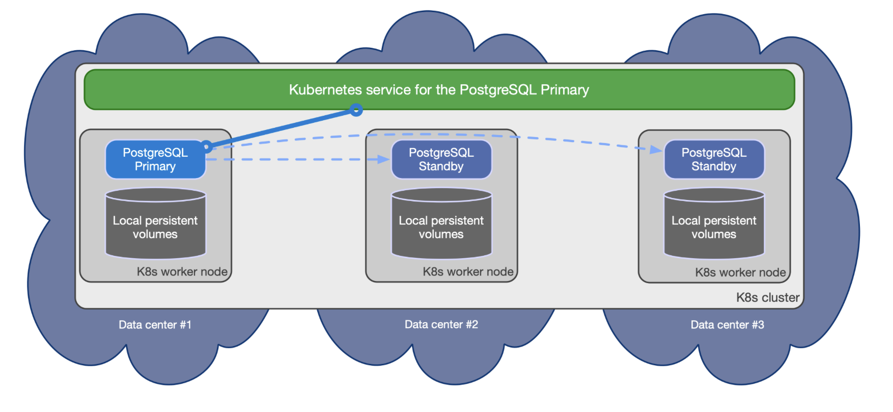

<!-- _class: lead -->
<!-- _paginate: skip -->
<!-- _footer: '' -->

# PostgreSQL : les fondamentaux

*Formation ENSAI 2026-2027*

`psql -h localhost -U admin -d appdb`

---

<!-- header: 'PostgreSQL' -->

## PostgreSQL en bref

PostgreSQL est un système de gestion de bases de données **relationnelles** open source.

- Très utilisé en production (finance, statistique, web…)
- Support du SQL standard et des transactions ACID
- Extensible : types personnalisés, extensions (PostGIS, pgvector…)

---

## Image Docker officielle

Image : `postgres:<version>`

Variables d'environnement essentielles :

| Variable | Rôle |
|----------|------|
| `POSTGRES_USER` | Nom de l'utilisateur administrateur |
| `POSTGRES_PASSWORD` | Mot de passe de cet utilisateur |
| `POSTGRES_DB` | Nom de la base créée au démarrage |

**Port par défaut** : `5432`

---

## Arborescence des données

```
/var/lib/postgresql/data/       # Répertoire des données (PGDATA)
├── base/                       # Données des bases
└── pg_wal/                     # Journaux de transactions (WAL)
```

> C'est ce répertoire qu'il faudra **persister avec un volume** dans Kubernetes pour ne pas perdre les données au redémarrage du pod.

---

## Fichiers de configuration

```
/var/lib/postgresql/data/
├── postgresql.conf
└── pg_hba.conf
```

| Fichier | Rôle |
|---------|------|
| `postgresql.conf` | Configuration du serveur : port, mémoire, connexions max, logs |
| `pg_hba.conf` | Contrôle d'accès : quels utilisateurs, depuis quelles IP, avec quelle méthode d'authentification |

---

## Ressources

- Documentation officielle de PostgreSQL : [postgresql.org/docs](https://www.postgresql.org/docs/)
- PGSimCity : [nikolays.github.io/PGSimCity](https://nikolays.github.io/PGSimCity/)

---

<!-- header: 'PostgreSQL · Helm & CloudNativePG' -->

## PostgreSQL sur Kubernetes : CloudNativePG

Plutôt que d'écrire soi-même StatefulSet, Service et Secret, on délègue à un **opérateur** : **CloudNativePG (CNPG)**.

- L'opérateur ajoute une ressource personnalisée (**CRD**) : `Cluster`
- On **décrit** le cluster PostgreSQL voulu, l'opérateur **crée et maintient** pods, volumes, services et secrets
- Il gère aussi réplication, bascule (failover) et sauvegardes

Deux charts Helm dans le repo `cnpg` :

| Chart | Rôle |
|-------|------|
| `cnpg/cloudnative-pg` | L'opérateur (installé **une fois** pour tout le cluster, déjà présent sur le SSP Cloud) |
| `cnpg/cluster` | Un cluster PostgreSQL géré par l'opérateur |

---

## Architecture d'un cluster PostgreSQL

Un `Cluster` CNPG = **1 primaire + N réplicas**, chaque instance dans son propre pod (`<c>` = nom du cluster) :



---

## Rôle de chaque composant

| Composant | Rôle |
|-----------|------|
| **Primaire** | Seule instance qui accepte les **écritures** |
| **Réplicas** | Copies en **lecture seule**, alimentées en continu par le WAL du primaire (*streaming replication*) |
| **PVC** | Un volume **par instance** : pas de stockage partagé, chaque réplica a sa propre copie des données |
| **Services** | `-rw` → primaire · `-ro` → réplicas · `-r` → toutes les instances |

**Bascule (failover)** : si le primaire tombe, l'opérateur promeut un réplica et fait pointer `-rw` vers lui. L'application, qui se connecte via le service, n'a rien à changer.

> `instances: 3` → 1 primaire + 2 réplicas. Dans le TP, `instances: 1` : un primaire seul, donc **pas de haute disponibilité**.

---

<!-- _class: code-sm -->

## CNPG comme dépendance d'un chart

```yaml
# Chart.yaml
dependencies:
  - name: cluster
    version: "0.0.9"
    repository: "https://cloudnative-pg.github.io/charts"
    alias: postgresql          # configuré via la clé postgresql: de values.yaml
```

```yaml
# values.yaml
postgresql:
  cluster:
    instances: 1
    storage:
      size: "1Gi"
    initdb:
      database: reviews
      owner: admin
```

```bash
helm dependency update ./mon-chart   # télécharge la dépendance dans charts/
```

---

## Ressources créées par CNPG

Pour une release `<release>` (alias `postgresql`) :

| Ressource | Nom | Usage |
|-----------|-----|-------|
| Cluster | `<release>-postgresql` | Ressource CNPG |
| Service | `<release>-postgresql-rw` | Primaire : lecture/écriture |
| Service | `<release>-postgresql-ro` | Réplicas uniquement : lecture |
| Service | `<release>-postgresql-r` | Toutes les instances : lecture |
| Secret | `<release>-postgresql-app` | Credentials applicatifs (`username`, `password`…) |

> Le port reste `5432`. Les variables `POSTGRES_*` de l'image Docker ne sont plus utilisées : c'est l'opérateur qui génère les credentials.

---

<!-- _class: code-sm -->

## Connecter une application

Injecter les credentials depuis le secret CNPG, sans les écrire dans `values.yaml` :

```yaml
env:
  - name: DB_HOST
    value: {{ printf "%s-postgresql-rw" .Release.Name | quote }}
  - name: DB_USER
    valueFrom:
      secretKeyRef:
        name: {{ printf "%s-postgresql-app" .Release.Name }}
        key: username
  - name: DB_PASS
    valueFrom:
      secretKeyRef:
        name: {{ printf "%s-postgresql-app" .Release.Name }}
        key: password
```

```bash
kubectl get clusters                                  # état du cluster PostgreSQL
kubectl exec -it <release>-postgresql-1 -- psql       # ouvrir psql dans l'instance 1
```
